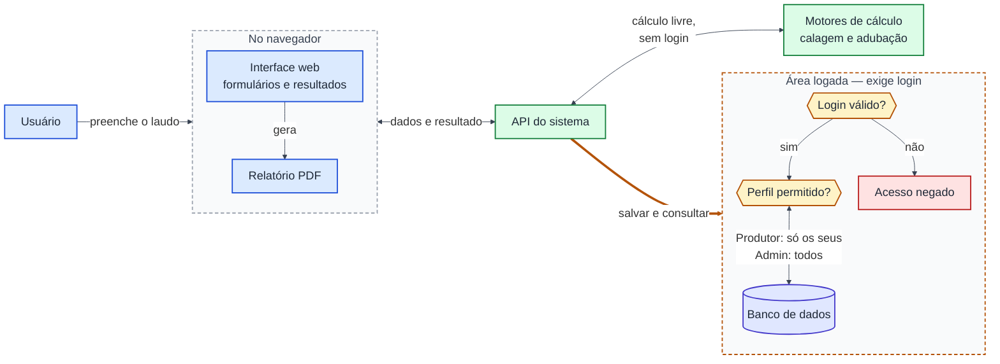
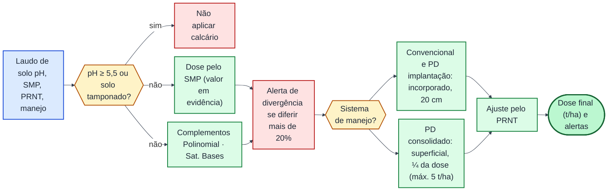
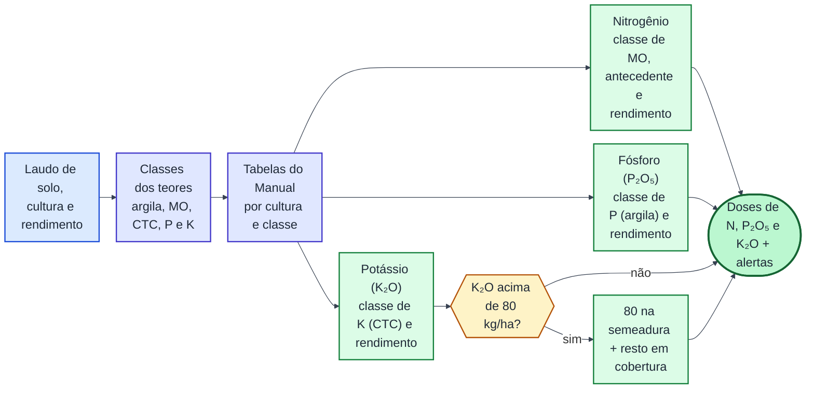

# Diagramas da apresentação — IbIFerti

Três diagramas em Mermaid, gerados a partir do código (`backend/src/routes`, `services`, `middlewares`, `database` e o gerador de PDF do frontend). Cada um tem no máximo 12 caixas e rótulos sem nomes de arquivo ou função.

---

## 1. Arquitetura da aplicação

---

## 2. Fluxo do motor de calagem

---

## 3. Fluxo do motor de adubação

---

## Notas de fidelidade (não entram no slide)

Para responder perguntas, o que cada diagrama simplifica em relação ao código:

**Diagrama 1**
- O PDF é montado no navegador a partir do resultado que a API devolveu. A API não gera PDF.
- A calculadora de calagem grava a análise automaticamente, como convidado se não houver login. A de adubação só calcula; salvar exige login.
- O login (e-mail e senha) devolve um token válido por 7 dias. A rota de login tem limite de tentativas. A área admin exige perfil Admin.

**Diagrama 2**
- A decisão "pH ≥ 5,5 ou solo tamponado" junta duas regras. O pH ≥ 5,5 vale para todos os sistemas. O solo tamponado (V ≥ 65% e Al < 10%) vale só no PD consolidado, com pH abaixo de 5,5.
- Os complementos aparecem em condições diferentes. O Polinomial é calculado se o técnico marcar ou se SMP > 6,3. A Saturação por Bases é calculada só com SMP ≤ 6,3.
- A divergência é o desvio do complemento em relação ao SMP: mais de 20% e pelo menos 0,5 t/ha, antes do PRNT. Sem divergência, nenhum alerta é emitido e o fluxo segue igual.
- O PD implantação em campo natural fica superficial com ½ da dose. O diagrama o omite.
- O PD com restrição também fica fora do diagrama.

**Diagrama 3**
- A conversão de Mehlich-3 para Mehlich-1 acontece antes da classificação e não aparece como caixa.
- O ajuste pelo rendimento esperado é aplicado a N, P e K. A densidade de plantas também ajusta o N do milho.
- As culturas fixadoras de N (como a soja) recebem N = 0 e um alerta de inoculação.
- A opção "correção Total" usa uma tabela própria de correção, somada à manutenção.
- A classe "muito alto" de P e K não consulta a tabela e fica sem dose. Essa regra diverge dos cenários da coordenadora e está pendente de resposta.
- Os alertas de diagnose secundária (S, Mo, micronutrientes, Ca e Mg) entram na caixa final.
